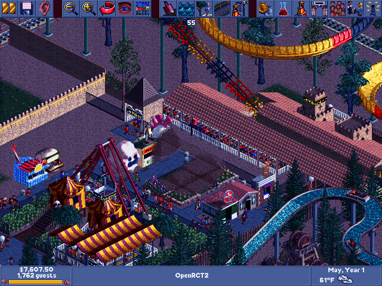
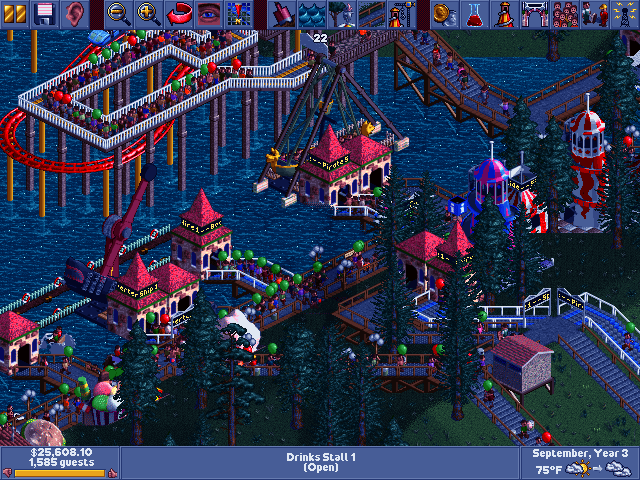

# OpenRCT2 for Mac OS 9

RollerCoaster Tycoon, running natively on a 450 MHz iMac G3 under Mac OS 9.



This is not an emulator or a remake. It is [OpenRCT2](https://openrct2.io), the
open-source reimplementation of RollerCoaster Tycoon 2, compiled for the PowerPC 750
with [Retro68](https://github.com/autc04/Retro68). Underneath is a new Classic Mac OS layer
covering files, memory, display, sound and input. The whole game is there: every
scenario from RCT1 and RCT2, rides, guests, staff, finances, saving and loading, and
sound. The simulation runs at the original 40 ticks per second, and it is bit-for-bit
deterministic across machines: after thousands of ticks, a park on the G3 is in exactly
the same state as the same park on a PC.

## What you need

- **A PowerPC Mac running Mac OS 9.** It was developed and tested on an iMac G3
  450 MHz (Summer 2000, ATI Rage 128 Pro, 1 GB RAM) with Mac OS 9.2.1. Other G3
  and G4 Macs should work but haven't been tried.
- **Memory:** 256 MB or more is best. The game asks for 256 MB and starts in
  as little as 100 MB. Smaller parks fit there, and sounds are then read from disk.
- **About 450 MB of disk space.**
- **Your own copy of the game data**, the same data OpenRCT2 needs:
  RollerCoaster Tycoon 2 (CD, Steam or GOG) or RollerCoaster Tycoon Classic (Steam
  or the Mac App Store). RollerCoaster Tycoon 1 (CD, Steam or GOG) can be added on
  top for its scenarios, graphics and music. The files are converted for the Mac on a
  modern computer; none of them are included here.
- **On the modern computer:** Python 3 and [ffmpeg](https://ffmpeg.org) (ffmpeg converts the sounds).

## Installing

1. **Get the program.** Download `RCT.bin`, `openrct2.pak` and `title.pak` from the
   [latest release](../../releases/latest), or [build them yourself](docs/building.md).

2. **Convert your game data.** On the modern computer, using this repository, point
   `tools/make_packs.py` at your game folder (or a .zip of it), then at an output folder:

   ```sh
   python3 tools/make_packs.py "path/to/RollerCoaster Tycoon 2" packs
   python3 tools/make_packs.py "path/to/RCT Classic" packs      # or Classic instead
   python3 tools/make_packs.py "path/to/RCT2" "path/to/RCT1" packs   # with RCT1 added
   ```

   It writes `game.pak`, `game2.pak` … (and `rct1.pak` … with RCT1) into `packs/`:
   about 380 MB for RCT Classic. If your RCT1 installation left its graphics on the CD,
   list the CD as another source; folders of the same game are merged.

3. **Copy everything to the Mac.** Use whatever you have: a FAT32 USB stick, a CD,
   FTP in binary mode or a file share. Decode `RCT.bin` with StuffIt Expander to get
   the **RCT** application. Put RCT and all the `.pak` files together in one folder.
   If your Mac runs [AgentChat](https://github.com/whiskthecat/agentchat-macos9), a
   coding agent can do this step and the next ones for you: see
   [docs/install-with-an-agent.md](docs/install-with-an-agent.md).

4. **Check the memory size** (only on Macs with less than about 384 MB). Select RCT,
   choose File → Get Info → Memory, and lower Preferred Size so it fits in your free
   RAM, or turn on virtual memory.

5. **Start RCT.** The first launch takes a minute or two, because it indexes the
   game's objects and scenarios. After that it reaches the title screen in a few seconds.

> **Volume warning.** The iMac G3's speakers are very loud. By default the game
> plays at no more than 25% of its own volume settings. To change the limit, create
> a text file named `RCT.txt` next to the application, containing for example
> `--volume=50`, or `--mute` for silence.

## Playing

- The game switches the screen to 256 colours and restores your desktop when it quits.
  Choose the resolution in Options → Display; 640×480 is the fastest.
- With a one-button mouse, Control-click is the right button: hold Control and drag
  to scroll the view. ⌘Q quits.
- Saved games live in `User/OpenRCT2/save` inside the game's folder.
- Some options exist only in this version: smooth-scrolling recovery, exact sprite
  depth in the main view, and a few interface layouts from the original game. Each
  one can be switched back to OpenRCT2's standard behaviour.
- Missing: multiplayer, plugins and TrueType fonts. Music plays in mono.



## Performance

Measured on the 450 MHz iMac G3 at 640×480 with large, late-game parks. In all of
these the simulation keeps full speed (40 ticks per second).

| Park | Guests | Standing still | Scrolling |
| --- | ---: | ---: | ---: |
| Evergreen Gardens | 1,333 | 52 fps | 36–39 fps |
| Six Flags Over Texas | 1,767 | 40 fps | 36–39 fps sideways, 24–25 fps up/down |

With Options → Interface → *Exact depth in main view (slower)* turned off, Six Flags Over
Texas stands at 64 fps and scrolls at 49–51 fps sideways and 29 fps up or down.
The exact setting is the default because it sorts sprites the same way OpenRCT2 does.

## How it works

The short version: the game draws into an 8-bit buffer that uses RCT's own palette as
the hardware colour table. Only changed rectangles are copied to the screen. When
the view scrolls, the video card moves the picture, and the game paints only the
newly exposed strip, from a cache of ready-sorted scenery columns. Simulation, UI and
drawing share one cooperative thread. Memory comes from a size-class allocator,
because the Mac Memory Manager can't cope with the game's hundreds of thousands of
small blocks. The tables are sized to the original game's limits instead of
OpenRCT2's much larger ones. [docs/how-it-works.md](docs/how-it-works.md) covers
the details, including a linker bug in the toolchain and how sound reaches the
Sound Manager.

## Repository layout

| Path | Contents |
| --- | --- |
| `patches/openrct2-classic-mac.patch` | All changes to OpenRCT2, against the revision pinned in `upstream.lock.json` |
| `compat/classic/` | The Mac OS layer: files, memory, sound, autosave, desktop integration |
| `compat/sdl/` | The display, input and drawing back end that replaces SDL |
| `tools/` | The game's entry point (`rctgame.cpp`), Mac resources, pack builders |
| `container/` | Build containers: Retro68 for the Mac, Debian for the data packs |
| `build.sh` | One-command build; see [docs/building.md](docs/building.md) |

## Credits and licence

OpenRCT2 is the work of the [OpenRCT2 team and contributors](https://github.com/OpenRCT2/OpenRCT2/blob/develop/contributors.md);
RollerCoaster Tycoon was created by Chris Sawyer. Retro68 is by Wolfgang Thaller.
This port, like OpenRCT2, is licensed under the GNU GPL version 3 (see `LICENSE`). It
is not affiliated with or endorsed by the OpenRCT2 project, Atari or Chris Sawyer.

Much of the port's code was written with AI coding agents. The work was directed,
and tested on the real machine, by a human.
